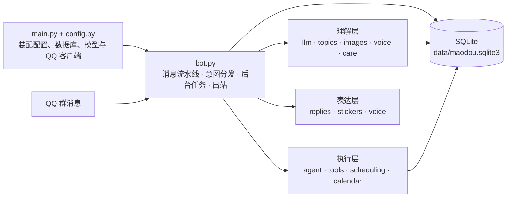
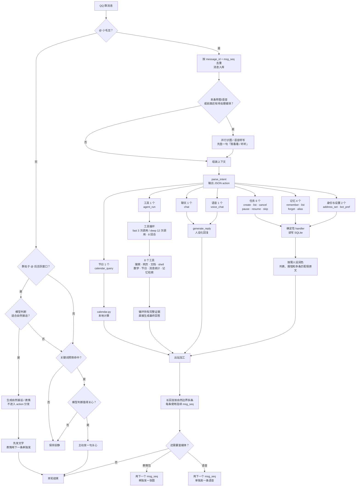

# 小毛豆

一个适合情侣私人群聊的 QQ 机器人，角色原型来自《洛克王国》的大耳帽兜。平时安静待在群里；被 @ 后会进入一段活跃会话，期间会判断是否自然接话，但只有 @ 消息才能执行任务和操作数据。

## 能做什么

- **聊天**：接话、开新话题、总结刚才聊了什么
- **看图**：聊天截图、照片、表情包都能认；连发多张后 @ 它，会先看最近一批（默认最多 9 张），同一张图只识别一次
- **听语音**：优先读取 QQ 自带转写；先发语音、下一条再 @ 也能补听，转写会进入当前话题和历史记录
- **发语音**：明确说「发语音 / 用语音说」时，直接发送一条 QQ 语音，不再先发文字；只有语音失败时才退回文字
- **搜索与阅读**：联网搜索、总结网页，读 PDF / Word / Excel / 文本，算数或在受限沙箱里跑命令
- **聊天记录检索**：能按你的要求翻当前群的历史消息，找相关原话并结合记忆回答；例如「查一下我们之前聊火锅的那几条」。记录按群隔离，新群不会自动继承旧群数据
- **消息统计**：可以统计今天、最近几天、本周等范围内每个人发了多少条，由本地数据库直接聚合，不靠猜
- **提醒**：单次、每天、每周、每年、每年农历；重要日子可提前 N 天预热提醒
- **记忆**：明确说「记住 xx」才入库，只有长期记忆一种；日常闲聊只压成摘要，不会自己往记忆里塞
- **节日日历**：公历农历互查，「中秋是几号」「最近有什么节日」
- **主动关心**：没被 @ 时也能察觉「累了 / 心情不好 / 肚子疼」，接一句 25 字以内的关心
- **活跃会话**：被 @ 后默认保持 10 分钟在场，期间没被 @ 的新消息也能自然接话；安静 3 分钟后最多主动补一句，也可以选择继续沉默
- **表情包**：16 张大耳帽兜主题表情图，先发文字再单独发图，一条回复最多一张
- **群内偏好**：@ 它说一声就能改，存在库里，优先级高于 `.env`

全部用自然语言，不用记命令：

```text
@小毛豆 总结一下我们刚才聊了什么
@小毛豆 每年 12 月 13 日 09:00 提醒我们纪念日，提前 3 天先提个醒
@小毛豆 每年农历冬月初五 08:30 给她过生日
@小毛豆 记住她的真名叫xx，一定要记住
@小毛豆 以后叫我「主人」，叫她「xx」
@小毛豆 中秋是几号
@小毛豆 搜一下周末上海有哪些展览
@小毛豆 查一下我们之前说火锅的那几条
@小毛豆 最近一周我们谁发得多
@小毛豆 发语音说晚安
```

## 运行

```powershell
.\.venv\Scripts\python.exe -m pip install -r requirements.txt
.\.venv\Scripts\python.exe main.py
```

Windows 下也可以用 `scripts\start.ps1` / `status.ps1` / `stop.ps1`。
QQ 开放平台选 WebSocket 连接，并开启接收群消息。

联网搜索和网页抓取由 DeepSeek 提供，直接复用 `.env` 里的 `LLM_API_KEY`；没配好时会明确说查不了，不会编造结果。
全站统一使用 `deepseek-flash`；`deepseek-chat` 只是旧别名，实际也会被网关路由到 `flash`。
日常闲聊默认关闭思考（`MAODOU_REASONING_EFFORT=none`）；图片识别首次用 `low`，失败会自动升到 `high` 再试；
deep 工具循环需要多步规划，使用 `MAODOU_DEEP_REASONING_EFFORT=high`。
闲聊类消息要先做一次意图分类、再生成回复，所以意图解析单独走快模型：默认 `deepseek-flash` +
`none`（`MAODOU_INTENT_MODEL` / `MAODOU_INTENT_REASONING_EFFORT`），最终回复仍用 `MAODOU_MODEL`，人设不受影响。
发语音优先使用 QwenCloud 的 `qwen-audio-3.1-tts-flash` + `longling_v3.1`
龙灵 04 试听版的软萌活泼女童声；没有配置时会退回无需额外 key 的 Edge 中文神经语音。
收语音优先使用 QQ 消息里的 `asr_refer_text`，缺失时才调用可选的外部 ASR。

## 代码架构

小毛豆是单进程、事件循环驱动的 QQ 群机器人：QQ WebSocket 事件进来后，由 `bot.py` 跑完整条消息流水线；理解、执行、表达和状态各自分层，所有长期状态落在本地 SQLite。



### 消息与 action 分支

群里每条消息先看有没有 @ 小毛豆。@ 消息进入主流程，由 `parse_intent` 分类到 16 个 action；没 @ 的消息在活跃窗口内只判断是否自然接话，否则走关键词主动关心。活跃接话不会执行任务、记忆、搜索、shell 或其他数据操作。



几个实现细节：

- 本地 action 先算出确定结果，再决定是否交给模型换语气；失败、列表和「匹配到多条」保持模板原文。
- 活跃窗口是进程内的群级状态：每次 @ 开启或刷新默认 10 分钟窗口，普通消息只更新最近发言时间。活跃期里，没 @ 的消息不会进入 `parse_intent`，因此不能借聊天触发任务、记忆、搜索、shell 或查库；这些操作仍然必须明确 @。
- 活跃会话连续安静默认 180 秒后，后台循环会问一次模型要不要补话。每段活跃会话最多尝试一次，且生成期间如果真人又说话了就放弃补话。
- `agent_run` 在同一个工具循环里持有完整证据并直接收口，不再做第二次润色，避免搜索结果在转述时丢失。最终落笔使用低思考预算和更大的正文 token 预算；若模型仍以 `finish_reason=length` 或悬空符号停下，会从断点续写，最多补两次。
- 最终提示词按输出契约分层：全局 `SYSTEM_PROMPT` 负责人设与交流方式；`chat` 直接用全局提示词；本地 action、fast 查询、deep 调研、结构化统计分别追加自己的事实和长度约束。
- 图片按字节 SHA-256 缓存描述；识图与回复并行，所以用户通常先看到「我看看图」，随后才收到正式答案。
- 语音转写会写回 SQLite，后续当前话题、历史检索和后台摘要都能看到；QQ 自带 ASR 缺失时才调用可选的外部 ASR。
- 长回复不会在发送前按字符数硬裁；发送层按空行、换行、句号等自然边界拆成多条，每条使用连续且唯一的 `msg_seq`。普通回复文字全部发完后，才用下一个 `msg_seq` 单独发表情图。中途失败不会重发已经送达的前文。
- `voice_chat` 只在用户明确要求发语音时触发，普通聊天不会自动转成语音。成功时只发送一条语音，不先发文字；TTS、上传或语音发送失败时才退回文字。语音回复不附表情包。

### 上下文工程

普通聊天不会把整库记录一股脑塞给模型，而是按用途分层：

| 上下文块 | 来源 | 规则 |
| --- | --- | --- |
| 身份信息 | `IdentityContext` | 当前触发者、另一位成员、登记过的称呼、显示名与说话人标签的对应关系 |
| 【当前话题】 | `topics.split_topic()` | 从最新消息往回扫；相邻间隔超过 45 分钟、达到 40 条或跨度超过 12 小时就切断 |
| 本次要回应 | 当前这条 @ 消息 | 去掉 @ 和表情标记；看图/听语音结果单独标成〔图〕/〔语音〕，不混进用户原话 |
| 【更早的背景】 | 上一话题末尾 | 最多 4000 字，只用来理解语气，不主动翻旧账 |
| 【最近聊天概要】 | `conversation_summaries` | 最近 2 段，总计最多 900 字；只由后台把日常闲聊压成摘要 |
| 【长期记忆】 | `memory_cards` | 只装稳定事实，按类型优先级和字符预算选取，不混入对话摘要 |
| 表情 / 检索结果 / 本轮操作 | 运行时生成 | 明确告诉模型这轮到底做了什么，避免它声称「记住了」「查过了」但实际没执行 |

长期记忆不会从日常聊天自动抽取：只有群里明确说「记住 xx」才写 `memory_cards`。后台摘要只是聊天梗概，和长期记忆是两套数据。

### 意图与工具

意图解析器共 16 个 action：

| 类别 | action | 执行方式 |
| --- | --- | --- |
| 定时任务 | `task_create`、`task_list`、`task_cancel`、`task_pause`、`task_resume`、`task_skip` | `bot.py` 本地 handler + SQLite |
| 长期记忆 | `memory_remember`、`memory_list`、`memory_forget`、`memory_alias` | `bot.py` 本地 handler + SQLite |
| 身份与群设置 | `address_set`、`bot_pref` | 写称呼表 / 群偏好表，群偏好优先于 `.env` |
| 节日查询 | `calendar_query` | `calendar.py` 直接计算 |
| 工具任务 | `agent_run` | `agent.py` 的 function-calling 循环 |
| 语音回复 | `voice_chat` | 先用普通聊天生成朗读正文，再直接合成并发送一条语音；成功时不发文字 |
| 普通聊天 | `chat` | `llm.generate_reply()` |

本地 action 先由代码算出可靠结果，再决定要不要让模型润色：成功确认可以换语气，但编号、报错和「匹配到多条」这类信息保持原样；模型若改写后丢了事实或把成功说成失败，会退回模板。

`agent_run` 内目前有 8 个工具：

| 工具 | 用途 |
| --- | --- |
| `web_search` | 联网搜索，返回标题、链接、来源和摘要 |
| `web_fetch` | 打开并阅读指定网页正文 |
| `document_read` | 读取 PDF / Word / Excel 等文档 |
| `shell_run` | 在服务器执行受限只读命令；默认禁止写操作和危险模式 |
| `math_eval` | 用 AST 校验后的表达式做数学计算 |
| `calendar_query` | 查某个节日或列出未来 30 天节日 |
| `message_stats` | 直接聚合数据库里的群消息数量 |
| `memory_search` | 同时搜索历史消息和长期记忆 |

循环使用 OpenAI 兼容的 `tools` 协议。`fast` 最多 3 次工具调用 / 3 个模型回合，`deep` 最多 12 次工具调用 / 8 个模型回合，单回合最多并行 3 个工具；模型不再调用工具、直接给出文本时就结束。调用预算用完后，最后一次「根据已有资料作答」的请求不再携带 `tools`，强迫模型基于证据收口。工具回合负责查证，最终正文使用独立预算；读取响应里的 `finish_reason` 后，不完整回答会自动续写，完整长回答则交给发送层拆条。网页抓取会拦截私网地址，shell 有命令白名单、超时和输出上限，避免模型把服务器当成无限制执行环境。

> 旧版的 `_handle_web_search` / `_handle_web_fetch` / `_handle_document_read` / `_handle_shell_run` / `_handle_math_eval` / `_handle_memory_search` / `_handle_message_stats` 还留在 `bot.py` 里，但正常分发已经全部走 `agent_run`，不会再从这些旧入口进入。

### 数据与后台任务

数据库是单个 SQLite 文件，按群 `group_openid` 隔离数据。主要表：

| 表 | 内容 |
| --- | --- |
| `messages` | 群消息原文、发送者、时间、来源；另有 FTS5 全文索引用于历史检索 |
| `processed_at_messages` | @ 事件去重 |
| `memory_cards` | 长期记忆：内容、类型、人物和来源消息 |
| `conversation_summaries` | 后台生成的聊天摘要，按消息 `row_id` 区间归档 |
| `scheduled_tasks` | 提醒与定时消息，包含周期、农历字段、提前天数和预热任务关联 |
| `person_aliases` / `person_addresses` | 同一个人的多种叫法，以及机器人该怎么称呼 |
| `group_preferences` | 每个群的主动关心和主动消息上限等设置 |
| `image_descriptions` | 图片字节指纹到文字描述的缓存 |
| `care_log` | 主动关心的发送记录与节流依据 |
| `face_tokens` | 群里见过的 QQ 小表情名字与标签 |

启动时 `store.py` 先建最终版 schema，再用 `PRAGMA table_info` 探测旧库缺列并 `ALTER TABLE`。只有约束本身变化（例如任务类型新增 `yearly`）时才整表重建，迁移过程不改写已有业务数据。

`on_ready` 后会启动一个后台循环：

- 每 `MAODOU_SCHEDULER_INTERVAL_SECONDS`（默认 30 秒）检查到期任务，发送后计算下一次运行时间。
- 同一轮后台检查会处理活跃会话：安静达到 `MAODOU_ACTIVE_FOLLOWUP_SECONDS`（默认 180 秒）后，最多判断一次要不要主动补话。
- 每 `MAODOU_MEMORY_INTERVAL_SECONDS`（默认 300 秒）把攒够的消息压成摘要。
- 未 @ 且不在活跃窗口的消息，先过 `care.py` 关键词预筛，再交给便宜模型判断要不要关心；同人冷却、每人每日上限、每群主动消息上限和 `care_log` 去重共同限流。

### 模型接口与扩展点

除 `agent_run` 使用原生 tool calling 外，其余结构化任务都用 JSON 模式和代码侧容错：

| 调用 | 用途 |
| --- | --- |
| `parse_intent()` | 自然语言 → 16 种 action 的 JSON |
| `generate_reply()` | 普通聊天，按上下文分层组装 prompt |
| `judge_active_reply()` | 活跃窗口里判断一条群消息是否适合自然接话，只输出 `{"reply": bool, "reason": "..."}` |
| `generate_active_reply()` | 活跃窗口里的自然接话与安静后补话；没有自然内容时可输出 `[SILENT]` |
| `generate_tool_reply()` | 一步式工具、action 确认和结构化统计的人设化表达；不参与 `agent_run` 的最终收口 |
| `describe_image()` | 视觉模型描述图片；失败自动重试并升到 `high` |
| `process_memory_batch()` | 聊天记录 → 150–300 字摘要，不产出长期记忆 |
| `judge_care()` | 主动关心的第二层判定，输出 `{"care": bool, "text": "..."}` |

扩展时通常只需要动这几处：

- **新增本地 action**：补 `INTENT_SYSTEM_PROMPT` 的 action 定义、`_handle_intent` 的分支和对应 handler。
- **新增 agent 工具**：在 `agent.py` 的 `AGENT_TOOLS` 加 schema，在 `_execute_tool` 加实现；真正的外部 I/O 放 `tools.py`。
- **新增数据字段**：同时修改 `_init_schema` 的最终建表语句和 `_ADDITIVE_COLUMNS`，保证新库与旧库迁移后的结构一致。
- **新增行为**：优先用提示词和上下文解决；只有需要确定性、权限控制或外部副作用时才写死在代码里。

## 部署

生产环境以 `maodou.service` 跑在 Linux 服务器的 `/opt/maodou`：

```powershell
.\scripts\deploy.ps1 -DryRun   # 先看要做什么，不动服务器
.\scripts\deploy.ps1 -Force    # fetch -> 跑测试 -> 备份数据库 -> 重启 -> 健康检查
.\scripts\rollback.ps1         # 出问题退回上一个已部署版本
```

部署会确认工作区干净且已 push，测试不过直接中止，健康检查失败自动回滚；版本记录在 `/var/lib/maodou-deploy/`。CI（GitHub Actions）在每次 push / PR 上跑 `compileall` 和全部单测。

换群后会拿到新的 `group_openid`，记忆等于清空；用 `scripts/migrate_group.py` 把旧群数据搬过去（加 `--list` 看群，`--dry-run` 预览，写库前自动留快照）。

## 隐私

聊天记录、媒体转写、图片描述和长期记忆都存在部署机器本地；生成回复时只把所需上下文发给配置的大模型服务。图片和语音原文件只在内存中识别/转写，原文件不落盘；数据库保存消息元数据、临时媒体 URL、图片文字指纹和语音转写。发送语音时，待朗读文本会交给 QwenCloud、Edge TTS 或你配置的其他 TTS 服务。`.env` 已加入 `.gitignore`，密钥不会提交。

表情图由群主提供，版权归原权利人，仅供私人群内使用。
